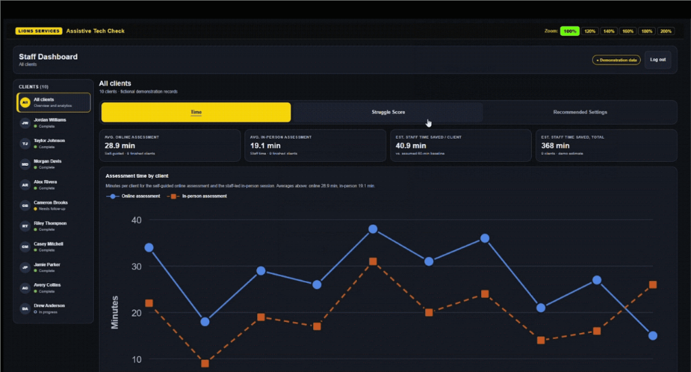

# Lions Services — AI Assistive Technology & Vocational Assessment Platform

An accessible, telemetry-driven evaluation and recommendation platform built for **Lions Services Inc.** to empower individuals who are blind or visually impaired to discover their optimal assistive technologies, workplace accommodations, and vocational career tracks.

The platform combines a **Braille Institute high-visibility neo-brutalist design system** (WCAG 2.1 AAA compliant), **proportional dynamic font & cursor scaling**, an **adaptive branching assessment engine**, and a **passive behavioral telemetry engine ("Hidden Struggle Detector")** that helps assistive technology specialists identify candidate friction without anxiety-inducing timers.

---

## Why This Exists

Traditional assistive technology evaluations for individuals with low vision or blindness often face significant operational and usability barriers:

1. **Clinical Tests vs. Real-World Functionality:** Standard Snellen eye charts (e.g., 20/70, 20/200) only measure biological acuity. They do not tell specialists whether a candidate can read prescription bottles, navigate a microwave, operate digital spreadsheets, or assemble manufacturing parts with tactile jigs.
2. **Inaccessible Evaluation Tools:** Ironically, many intake questionnaires and registration portals are themselves inaccessible—featuring faint gray text, rigid fixed-pixel layouts that break upon zooming, and complex dropdowns that confuse screen readers.
3. **Unreported Struggle & Fatigue:** Candidates often hesitate to verbally admit when they are struggling with a question or interface element. Without behavioral telemetry, specialists miss subtle motor tremors, excessive mouse wandering, or decision paralysis.
4. **Staff Documentation Overhead:** Intake specialists spend hours manually transcribing candidate notes, matching equipment trial requests, and drafting employer accommodation letters.

### How This Platform Solves It:
- **Instant 20/70 Triage Gate:** Self-identifies whether a candidate needs an immediate 4-step visual comfort check or can jump directly into self-serve vocational assessments.
- **Braille Institute Tactile Neo-Brutalism:** High-contrast color palettes (Dark Amber `#FFD700`, Cyan Light Mode `#E3F8FF`), thick tactile borders (`0.15rem`), and offset hard block shadows (`-0.35rem 0.35rem`) that provide clear tactile boundaries for low-vision users.
- **Proportional `rem` & Dynamic Cursor Synchronization:** Real-time scaling from 16px to 32px base font size that scales all text and controls proportionally across the entire app, alongside 4 distinct cursor scales (Normal, 32px Large, 48px XL, 64px Neon Green).
- **Adaptive Multi-Track Branching:** Automatically branches into **Personal Independence** (kitchen, medication, mail, mobility) or **Career & Employment** (digital office suites vs. Lions Services tactile manufacturing tracks).
- **Passive Behavioral Telemetry:** Passively tracks hover switches, answer changes, dead-space misclicks, and dwell times (with a 60-second screen-reader-safe threshold) to flag candidate friction directly to staff.
- **Direct Specialist Handoff:** Enables candidates to request on-site equipment trials, like/dislike recommendations, and submit contact requests directly into the staff dashboard.

---

## Preview

| 1. Welcome & Initial 20/70 Triage Gate | 2. Adaptive Visual Comfort & Calibration |
| :---: | :---: |
|  |  |
| *Initial candidate intake with 20/70 visual acuity triage gate.* | *Live text scaling slider, high-contrast themes & cursor practice area.* |

| 3. Mouse-Driven Branching Assessment | 4. Personalized Recommendations & Feedback |
| :---: | :---: |
|  |  |
| *Tactile MCQ cards with Segmented Progress Pill Bar.* | *Tailored assistive tools with Like/Dislike feedback & Staff handoff.* |

| 5. Lions Services Staff Review Dashboard |
| :---: |
|  |
| *Real-time candidate intake, struggle detection flags, and session history.* |

---

## Core Capabilities & Technical Innovations

### 1. WCAG 2.1 AAA Accessibility & Braille Institute Styling
- **Proportional `rem` Scaling:** All typography, margins, paddings, and button dimensions use relative `rem` units tied dynamically to `--app-base-font-size`, ensuring flawless scaling up to 200%+ without clipping or horizontal overflow.
- **Tactile Block Shadows & Focus Rings:** Interactive elements feature hard offset shadows (`-0.35rem 0.35rem 0px`) and high-visibility dual-contrast focus outlines (`0.2rem solid var(--btn-accent-bg)` with `0.15rem` offset).
- **Persistent Text Size & Contrast Menu:** Accessible popover in `<header role="banner">` allowing immediate toggling of **Large Text** (+133%), **Light Mode** (black on soft cyan `#E3F8FF`), and **Dark Mode** (amber on pitch black `#0A0A0A`).
- **Semantic DOM Landmarks:** Dedicated `<main id="main-content" role="main" aria-live="polite">`, proper `<h1>` auto-focus on route transitions, and semantic `<ul role="list">` button groups for native NVDA/JAWS/VoiceOver screen reader support.

### 2. Adaptive Branching Assessment Engine
- **Primary Fork:** Routes between **Personal Independence** and **Career & Employment**.
- **Personal Branch:** Deep-dives into daily barriers (Prescription medication, kitchen/cooking, mail & utility bills, smart mobility apps, and tactile home kits).
- **Career Branch:**
  - *Set Career Path:* Workstation ergonomics, dual-monitor screen magnification (ZoomText/JAWS), and high-contrast keyboards.
  - *Career Exploration:* Matches strengths into Art & Creative, Digital Office, Technology, or Lions Services Precision Manufacturing & Assembly.
- **Segmented Progress Pill Bar:** Horizontal tactile blocks with completed checkmarks (`✓`) and active focus indicators for candidates with peripheral vision loss.

### 3. Passive Behavioral Telemetry ("Hidden Struggle Detector")
Custom React hook (`useQuestionTelemetry`) that operates silently without visible countdown clocks to prevent anxiety:
- **`hoverSwitches`:** Tracks rapid cursor oscillation back-and-forth between buttons (`onMouseEnter`).
- **`answerChanges`:** Counts how many times a user flips their selection before advancing.
- **`misclicks`:** Captures clicks on background dead space outside valid interactive targets.
- **`uiTweaksMidQuestion`:** Detects if the user had to open the Contrast/Font menu mid-question to read text.
- **`dwellTimeMs`:** Measures task elapsed time, utilizing a relaxed **60-second threshold** to eliminate false positives for deliberate readers and screen-reader users.
- **Staff Diagnostic Categorization:** Automatically classifies struggle reasons into `visual_motor`, `cognitive_indecision`, or `slow_reading`.

### 4. Dual-Layer Storage & Offline Resiliency
- **Zero-Data-Loss Architecture:** Real-time synchronization to browser `localStorage` ensures that if a tablet loses Wi-Fi connection during an evaluation at a community kiosk, the session resumes seamlessly.
- **Anonymized SQLite Database:** Candidate sessions and telemetry are indexed by reference codes (`P-XXXX`) to minimize PII/HIPAA liability while preserving detailed records for assistive tech specialists.

---

## Tech Stack & Architecture

```
Team-26/
├── frontend/
│   ├── src/
│   │   ├── pages/
│   │   │   ├── Home.jsx                 # Candidate entry & session rehydration
│   │   │   ├── Acuity.jsx               # 20/70 Visual Acuity Triage Gate
│   │   │   ├── VisualSettings.jsx       # Color vision routing gate
│   │   │   ├── ColorVision.jsx          # Live text size slider & color swatches
│   │   │   ├── Assessment.jsx           # 4-Step Comfort Calibration (Mag, Contrast, Speech, Cursor)
│   │   │   ├── AssessmentScreen.tsx     # Branching MCQ assessment with telemetry
│   │   │   ├── SkillsResults.tsx        # Tailored recommendations & feedback reactions
│   │   │   ├── Contact.jsx              # Lions Services staff consultation intake
│   │   │   └── Staff.jsx                # Specialist dashboard & telemetry triage
│   │   ├── telemetry/
│   │   │   ├── useQuestionTelemetry.ts  # Behavioral struggle detector hook
│   │   │   ├── assessmentTree.ts        # Question paths & recommendation rules
│   │   │   └── McqQuestionCard.tsx      # Tactile cards & Segmented Progress Bar
│   │   ├── sessions/
│   │   │   ├── store.ts                 # SQLite database repository & sync
│   │   │   ├── project.ts               # Session telemetry aggregation
│   │   │   └── types.ts                 # Data models & schemas
│   │   ├── prefs.js                     # Dynamic font-size, palette & cursor engines
│   │   ├── settings.css                 # Braille Institute neo-brutalist design system
│   │   └── home.css                     # Persistent tactile cursor scales & viewport styles
│   └── package.json
└── assets/                              # Application preview screenshots
```

- **Frontend Core:** React 18, Vite, TypeScript
- **Styling:** Pure CSS (WCAG 2.1 AAA High-Contrast Neo-Brutalism, no heavy CSS frameworks)
- **Local Persistence & Server:** SQLite via Node.js / `better-sqlite3` and `localStorage`
- **Speech & Audio:** Web Speech Synthesis API & Web Audio API Earcons

---

## Getting Started

### Prerequisites
- **Node.js:** v18.0.0 or higher
- **npm:** v9.0.0 or higher

### Local Installation & Startup

1. **Clone the repository:**
   ```bash
   git clone https://github.com/nhp93/CFG---AI-Assistive-Technology-Assessment-Platform.git
   cd CFG---AI-Assistive-Technology-Assessment-Platform/frontend
   ```

2. **Install dependencies:**
   ```bash
   npm install
   ```

3. **Start the local development server:**
   ```bash
   npm run dev
   ```

4. **Open in browser:**
   Navigate to [http://localhost:5173](http://localhost:5173) to start the assessment.

5. **Staff Portal Access:**
   Click the **`Staff Portal`** button in the top navigation bar or navigate directly to `#/staff` to review candidate sessions and telemetry flags.

---

## Contributors

| Name | Role | Contact |
| :--- | :--- | :--- |
| **Phuc Nguyen Hong** | Full-Stack & Accessibility Engineer | [GitHub](https://github.com/nhp93) · nghongphuc93@gmail.com |
| **Team 26 Members** | JPMC Code for Good Columbus | Lions Services Inc. Challenge |

---

## License

This project was developed during the **JPMorgan Chase Code for Good 2026 Hackathon** in collaboration with and for the benefit of **Lions Services Inc.**
