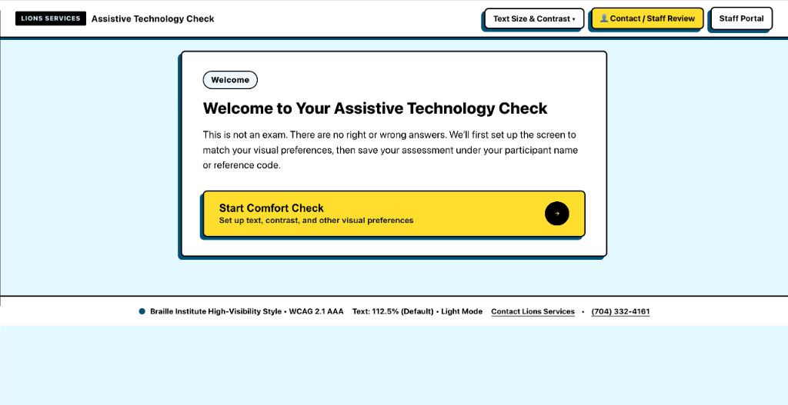
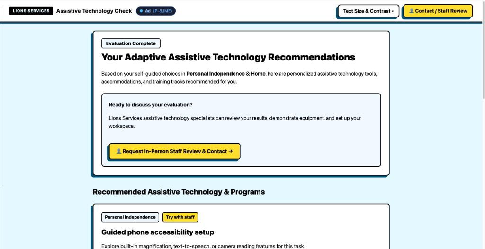
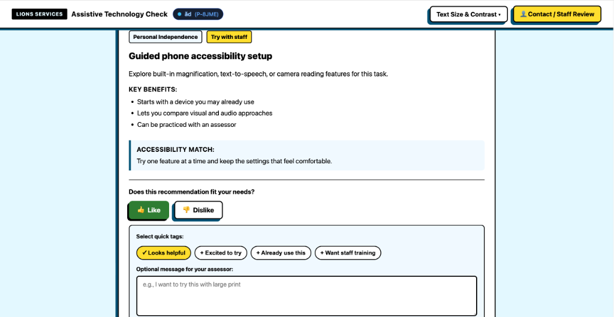
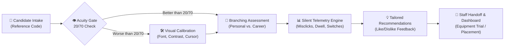

<div align="center">

# 🌟 Lions Services — Assistive Technology Assessment Platform
### *Empowering Blind & Low-Vision Individuals Through Adaptive Self-Serve Evaluations*

[](https://www.jpmorganchase.com)
[](https://www.w3.org/WAI/standards-guidelines/wcag/)
[](https://reactjs.org/)
[](https://vitejs.dev/)

<p align="center">
  A high-visibility, telemetry-driven platform built for <strong>Lions Services Inc.</strong> that replaces paper-heavy, 3-hour clinical intakes with an intuitive, self-guided evaluation that matches candidates to assistive tools and career tracks in under 40 minutes.
</p>

---

### 🚀 Key Impact at a Glance

| ⏱️ **78% Time Saved** | 🎯 **WCAG 2.1 AAA** | 🔍 **Zero-Anxiety Telemetry** | 💼 **Vocational Pathways** |
| :--- | :--- | :--- | :--- |
| Projects cutting evaluations from **3 hours down to under 40 mins**. | Braille Institute tactile styling with proportional `rem` scaling. | Passive struggle detector flags friction without countdown timers. | Direct matching for personal independence and manufacturing jobs. |

</div>

---

## 📸 Preview

| 1. Candidate Intake & 20/70 Triage Gate | 2. Tailored AT Recommendations |
| :---: | :---: |
|  |  |
| *High-contrast tactile cards & instant acuity triage.* | *Adaptive evaluation summary & 1-click staff review CTA.* |

| 3. Interactive Feedback & Quick Tags | 4. Staff Analytics & Telemetry Dashboard |
| :---: | :---: |
|  |  |
| *Candidate 👍/👎 reactions, quick tags & assessor notes.* | *Real-time client roster, struggle flags & time saved analytics.* |

---

## 💡 How It Works



---

## ✨ Core Features

### 1. Braille Institute High-Visibility Design (WCAG 2.1 AAA)
* **Proportional Scaling:** Base font-size scales dynamically from 16px to 32px; all containers, padding, and text adjust proportionally in `rem` units without layout breakage.
* **Tactile Neo-Brutalism:** Thick borders (`0.15rem`), offset block shadows (`-0.35rem 0.35rem`), and high-contrast dual themes (Dark Amber `#FFD700` on Black `#0A0A0A`, Light Cyan `#E3F8FF`).
* **Dynamic Cursor Engine:** 4 distinct cursor scales (Normal, 32px Large, 48px XL, and 64px Neon Green) that maintain visibility across all interactive elements.

### 2. Adaptive Branching Assessment
* **Personal Independence Track:** Evaluates daily task friction (medication management, kitchen dials, personal mail, and community mobility).
* **Career & Employment Track:** Tailors recommendations for current office software (ZoomText, JAWS, high-contrast keyboards) or discovers strength-based placement in Lions Services' specialized tactile manufacturing tracks.
* **Segmented Progress Pill Bar:** Tactile horizontal progress blocks with completed checkmarks (`✓`) designed specifically for users with peripheral vision loss.

### 3. Passive Behavioral Telemetry ("Hidden Struggle Detector")
Operates silently in the background without stressful visible timers:
* 🖱️ **Dead-Space Misclicks:** Identifies disorientation by tracking clicks outside interactive targets.
* ↔️ **Hover Oscillations:** Detects decision hesitation when users rapidly alternate between choices.
* ⏱️ **Screen-Reader-Safe Dwell Time:** Relaxed 60-second threshold prevents false positives for screen-reader users or deliberate readers.
* 🚨 **Automated Staff Triage:** Categorizes struggle reasons into `visual_motor`, `cognitive_indecision`, or `slow_reading`.

### 4. Resilient Dual-Layer Architecture
* **Offline-First Auto-Save:** Per-question state is synchronized to client storage, ensuring zero data loss if Wi-Fi drops on community center tablets.
* **Anonymized Staff Repository:** Lightweight SQLite backend tracks candidate evaluation profiles via privacy-safe reference codes (`P-XXXX`).

---

## 🛠️ Tech Stack

- **Frontend:** React 18, Vite, TypeScript
- **Accessibility:** WCAG 2.1 AAA, WAI-ARIA 1.2, Pure CSS Neo-Brutalism
- **Audio & Speech:** Web Speech Synthesis API & Web Audio API (earcon cues)
- **Data & Telemetry:** Embedded SQLite, LocalStorage dual-sync, Custom Telemetry Hooks

---

## ⚡ Quick Start

```bash
# 1. Clone the repository
git clone https://github.com/nhp93/CFG---AI-Assistive-Technology-Assessment-Platform.git
cd CFG---AI-Assistive-Technology-Assessment-Platform/frontend

# 2. Install dependencies
npm install

# 3. Start local development server
npm run dev
```

Open [http://localhost:5173](http://localhost:5173) in your browser. Access the Staff Portal anytime via `#/staff`.

---

## 👥 Contributors

| Contributor | Focus Area | Contact |
| :--- | :--- | :--- |
| **Phuc Nguyen Hong** | Full-Stack & Accessibility Engineering | [GitHub](https://github.com/nhp93) · nghongphuc93@gmail.com |
| **Team 26 Members** | JPMorgan Chase Code for Good 2026 | Non-Profit Challenge |

---

<div align="center">
  <sub>Built with ❤️ during the <strong>JPMorgan Chase Code for Good 2026 Hackathon</strong> for <strong>Lions Services Inc.</strong></sub>
</div>
